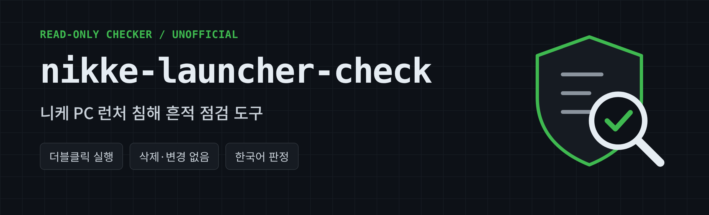

<p align="center"></p>

# nikke-launcher-check

[한국어](README.md) | [English](README.en.md) | [日本語](README.ja.md) | [繁體中文](README.zh-Hant.md) | [简体中文](README.zh-Hans.md)

Windows checker for known traces of the NIKKE PC launcher compromise reported in November 2026.

- **Read-only:** deletes nothing, changes nothing, closes nothing, blocks nothing, sends nothing. Warnings only.
- **Not a removal tool.** It reports traces and does not remove them.
- **Unofficial.** Not affiliated with SHIFT UP or Level Infinite.

> **"No traces" does not mean safe.** Only published indicators are checked. If you ran the launcher after Oct 23, 2026 (GMT), changing key passwords and signing out of sessions is recommended regardless of the result.

> **Verification:** v0.3.1 was tested only in simulated environments. Registry, signature and network checks are not yet verified on real Windows. Translations are machine-made; report errors via Issues.

## Usage

1. Download the zip from [Releases](../../releases) and extract it.
2. Double-click `nikke_check.bat`. Admin rights are not needed.
3. Run it on the Windows account that used NIKKE.
4. The result appears on screen and is saved to your Desktop as `NIKKE_check_<date>_<time>.txt`.

## Check with an AI assistant

If you use an AI tool that can run commands on your PC (Claude, ChatGPT, etc.), you can paste this:

```text
Check this PC with the latest NIKKE PC launcher checker release.
https://github.com/safe-launcher-check/nikke-launcher-check/releases/latest

1. Download the release zip to a new temp folder and extract it.
2. Compare the zip's SHA-256 with the release page. Stop if it differs.
3. Read nikke_check.ps1 and report whether it has delete, change or network commands. If it does, do not run it.
4. Run it on the current account without admin rights. Stop and tell me if it takes over 5 minutes.
   powershell.exe -NoProfile -ExecutionPolicy Bypass -File .\nikke_check.ps1 -NoPrompt
5. Explain the result in plain language. Do not describe "no traces" as safe.

Rules: do not delete or change files, folders or registry entries. Do not run the NIKKE launcher. Hide my username and PC name, and never write passwords or tokens.
```

- **On a PC with a DANGER result, do not trust AI tools either.** This malware also targets AI tool credentials. Revoke and reissue those tokens from another device.
- Using AI is optional. Double-clicking `nikke_check.bat` gives the same result.
- AI explanations can be wrong, so read the result txt yourself.

## Options

`-Language ko|en|ja|zh-Hant|zh-Hans`, `-NikkePath "D:\NIKKE"`, `-DeepScan`, `-AllUsers`

## If DANGER appears

Close the launcher or disconnect. Delete the HKCU key, restart, then delete only the 64-hex folder. Do not delete the whole PlatformExperienceHelper folder or the HKLM entry. Reinstalling Windows is safest. From a clean device, change passwords, enable 2FA, sign out of all sessions, reissue tokens and keys, and move crypto to a new wallet.

---

Source: [MotherSphere public report](https://gist.github.com/MotherSphere/d6c049a09ba8ac3085c51ee9df24a4e5), 2026-11-04 02:00 GMT revision, and victim reports in its comments. Not an official statement. Provided under the MIT license with no warranty.
