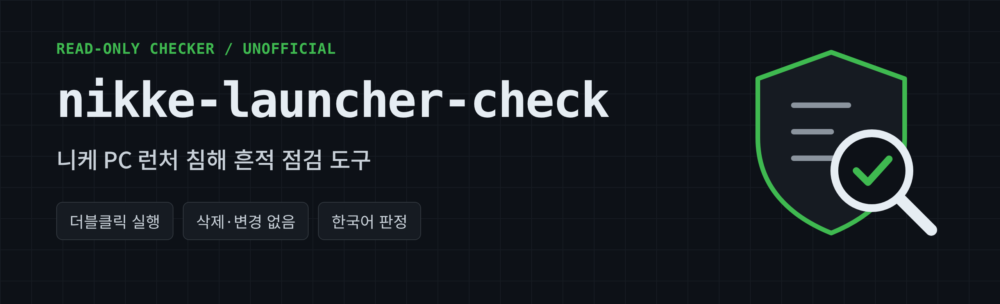

# nikke-launcher-check

[한국어](README.md) | [English](README.en.md) | [日本語](README.ja.md) | [繁體中文](README.zh-Hant.md) | [简体中文](README.zh-Hans.md)

2026年11月に報告されたNIKKE PCランチャー侵害の既知の痕跡を確認するWindows用ツールです。

- **読み取り専用:** 削除、変更、終了、ブロック、外部送信を行いません。警告のみです。
- **除去ツールではありません。** 痕跡を知らせるだけです。
- **非公式です。** SHIFT UP、Level Infiniteとは関係ありません。

> **「痕跡なし」は安全という意味ではありません。** 公開された指標のみ確認します。2026年10月23日(GMT)以降にランチャーを起動した場合、結果にかかわらず主要パスワードの変更とセッションのログアウトを推奨します。

> **検証状況:** v0.3.0は模擬環境でのみテストしました。レジストリ、署名、ネットワークの確認は実際のWindowsで未検証です。翻訳は機械翻訳です。誤りはIssuesでお知らせください。

## 使い方

1. [Releases](../../releases) からzipをダウンロードして展開します。
2. `nikke_check.bat` をダブルクリックします。管理者権限は不要です。
3. NIKKEを使っていたWindowsアカウントで実行してください。
4. 結果は画面に表示され、デスクトップに `NIKKE_check_日付_時刻.txt` として保存されます。

## オプション

`-Language ko|en|ja|zh-Hant|zh-Hans`, `-NikkePath "D:\NIKKE"`, `-DeepScan`, `-AllUsers`

## 「危険」と表示されたら

ランチャーを閉じるかネットワークを切断します。HKCUキーを削除し、再起動してから64桁のフォルダのみ削除します。PlatformExperienceHelperフォルダ全体とHKLMの項目は削除しないでください。最も安全なのはWindowsの再インストールです。別のクリーンな端末でパスワード変更、二段階認証、全セッションのログアウト、トークンと鍵の再発行、暗号資産の新しいウォレットへの移動を行ってください。

---

出典: [MotherSphereの公開報告書](https://gist.github.com/MotherSphere/d6c049a09ba8ac3085c51ee9df24a4e5) 2026-11-04 02:00 GMT版およびコメントの被害報告。公式発表ではありません。MITライセンス、無保証です。
