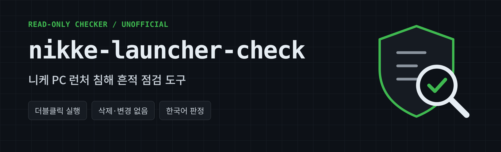
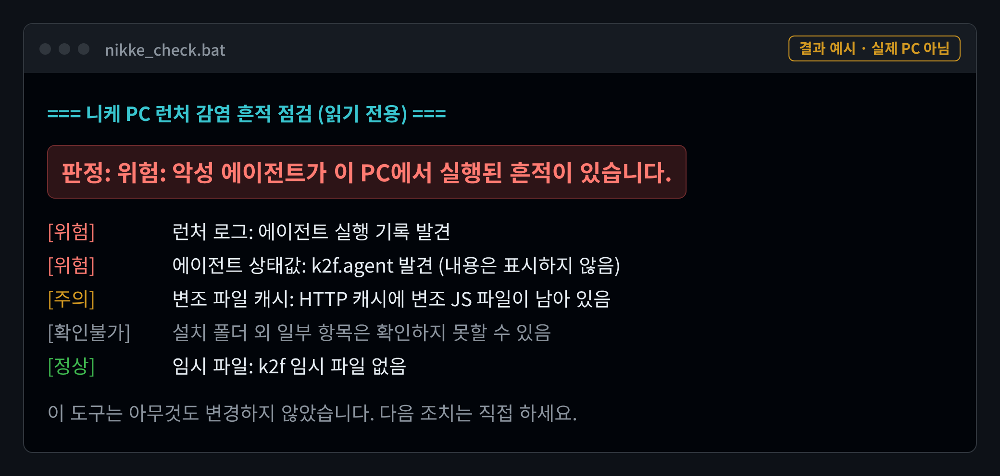

<p align="center"></p>

# nikke-launcher-check

한국어 | [English](README.en.md) | [日本語](README.ja.md) | [繁體中文](README.zh-Hant.md) | [简体中文](README.zh-Hans.md)

승리의 여신: 니케 PC 런처 침해 사고(2026년 11월 공개)의 알려진 흔적을 찾는 Windows용 점검 도구입니다.

- **읽기 전용:** 파일 삭제, 레지스트리 변경, 프로세스 종료, 차단 설정, 외부 통신을 하지 않습니다. 발견하면 경고만 합니다.
- **치료 도구가 아닙니다:** 흔적을 찾아 알려줄 뿐 제거하지 않습니다.
- **비공식 도구입니다:** SHIFT UP, Level Infinite와 관련이 없습니다.

> **"흔적 미발견"은 안전하다는 뜻이 아닙니다.** 공개된 지표만 검사하므로, 로그가 삭제됐거나 흔적이 지워졌으면 찾지 못합니다. 2026년 10월 23일(GMT) 이후 PC 런처를 실행했다면 결과와 상관없이 주요 비밀번호 변경과 세션 로그아웃을 권장합니다.

> **검증 상태:** v0.3.0은 가짜 테스트 환경에서만 시험했습니다. 레지스트리, 서명, 네트워크 검사는 실제 Windows 환경에서 아직 검증되지 않았습니다. 오류나 이상한 결과는 Issues로 알려주세요.

지표 기준: MotherSphere 공개 보고서 2026-11-04 02:00 GMT 갱신본

## 사용법

1. [Releases](../../releases)에서 zip을 받아 압축을 풉니다.
2. `nikke_check.bat`을 더블클릭합니다. 관리자 권한은 필요 없습니다.
3. **니케를 쓰던 Windows 계정**으로 실행하세요. 다른 계정으로 실행하면 그 계정의 폴더와 레지스트리를 검사합니다.
4. 결과는 화면에 표시되고 바탕화면에 `NIKKE_check_날짜_시간.txt`로 저장됩니다.

설치 폴더를 못 찾으면 경로를 물어봅니다. PowerShell에서 직접 지정할 수도 있습니다.

```powershell
powershell -NoProfile -ExecutionPolicy Bypass -File .\nikke_check.ps1 -NikkePath "D:\NIKKE"
```

옵션: `-DeepScan`(드라이브 정밀 탐색), `-AllUsers`(로드된 다른 계정의 레지스트리 확인), `-Language ko|en|ja|zh-Hant|zh-Hans`(언어 지정, 기본은 Windows 언어)

구글 플레이 게임즈판을 쓰는 경우 폴더 이름에 NIKKE가 있으면 함께 찾습니다. 못 찾으면 `-NikkePath`로 지정하세요. 구글 플레이 게임즈판 영향은 커뮤니티 제보이며 공식 확인 내용이 아닙니다.

SmartScreen이나 백신이 경고할 수 있습니다. 실행 전에 `nikke_check.ps1` 내용을 직접 읽어보거나, 릴리스의 SHA-256 값과 비교하세요.

```powershell
Get-FileHash .\nikke-launcher-check-v0.3.0.zip -Algorithm SHA256
```



## 판정

| 판정 | 의미 |
| --- | --- |
| 위험 | 악성 에이전트 실행 또는 지속성 흔적 발견 |
| 주의 | 실행 기록은 없지만 변조 파일이나 공격자 서버 접속 흔적 발견 |
| 판정 제한 | 로그나 설치 폴더가 없어 실행 여부 확인 불가 |
| 알려진 흔적 미발견 | 공개 지표가 발견되지 않음. 안전 보장은 아님 |

결과 파일에는 찾은 문자열 자체를 적지 않지만, 파일 경로에 Windows 사용자명이 들어갈 수 있습니다. 공유 전에 확인하세요.

## 검사 항목

- `Launcher\intl_service\debug.log`의 에이전트 실행 기록
- `Launcher\log\tinyget`의 페이로드 다운로드 기록
- `%APPDATA%\nikke_launcher`의 `k2f.agent` 상태값, 코드 캐시, 변조 파일 캐시
- AppData 전체의 `platform_experience_helper.dll`과 브라우저 프로필 18종의 `PlatformExperienceHelper\<64자리 16진수>` 폴더
- HKCU `CLSID`와 `Wow6432Node\CLSID`의 `{E77CC89B-7401-4C04-8CED-149DB35ADD04}`, 같은 DLL을 가리키는 다른 COM 등록
- 페이로드 파일 크기와 해시, 로그의 PC 이름 일치 여부(이름은 표시하지 않음)
- `%TEMP%`의 `k2f-bcreds-*`, `k2f_screen_*`
- 공격자 서버 IP 연결, DNS 캐시, 런처 실행 여부

`PlatformExperienceHelper` 폴더 자체는 Chrome 정상 폴더입니다. HKLM의 같은 CLSID도 Windows 정상 항목이니 지우지 마세요.

## "위험"이 나오면

1. 런처를 닫거나 인터넷을 끊습니다.
2. HKCU CLSID 키 삭제, 재부팅, 64자리 폴더만 삭제 순서로 진행합니다. 가장 안전한 방법은 Windows 재설치입니다.
3. 깨끗한 다른 기기에서 비밀번호를 바꾸고, 2단계 인증을 켜고, 모든 세션을 로그아웃합니다.
4. API 토큰, SSH 키, 개발자 자격증명을 폐기하고 재발급합니다.
5. 암호화폐 지갑은 새 시드의 새 지갑으로 옮깁니다.

백신 검사가 깨끗해도 제거를 보장하지 않습니다. Defender 오프라인 검사가 DLL을 찾지 못한 사례가 보고됐습니다.

## 출처와 교차 점검

탐지 지표와 대응 절차는 [MotherSphere의 공개 보고서](https://gist.github.com/MotherSphere/d6c049a09ba8ac3085c51ee9df24a4e5)와 그 댓글의 피해자 제보를 바탕으로 합니다. 공식 발표가 아니며 이후 내용이 바뀔 수 있습니다.

다음 공개 도구의 검사 항목도 참고해 직접 구현했습니다. 코드를 복사하지 않았으며, 두 도구 모두 비공식입니다. 교차 점검에 쓸 수 있습니다.

- [saica1101/Nikke-Malware-Checker](https://github.com/saica1101/Nikke-Malware-Checker): 읽기 전용
- [neutralnikke/Check-NikkeK2f.ps1](https://gist.github.com/neutralnikke/b7fcab99e8b64758f699f3bb8bdd14fd): 확인 후 삭제 기능 포함, 실행 전 내용 검토 필요

## 면책

MIT 라이선스로 제공되며 어떤 보증도 하지 않습니다. 결과를 근거로 한 판단과 조치의 책임은 사용자에게 있습니다.
