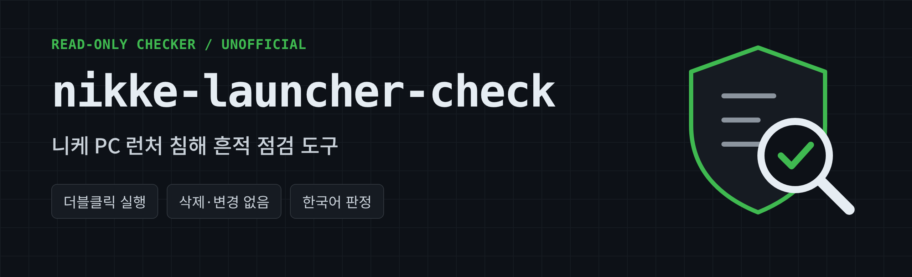

<p align="center"></p>

# nikke-launcher-check

[한국어](README.md) | [English](README.en.md) | [日本語](README.ja.md) | [繁體中文](README.zh-Hant.md) | [简体中文](README.zh-Hans.md)

用于检查 2026 年 11 月报告的 NIKKE PC 启动器遭入侵事件已知痕迹的 Windows 工具。

- **只读：** 不删除、不更改、不关闭、不拦截、不外传，只显示警告。
- **不是清除工具。** 只报告痕迹，不会移除。
- **非官方。** 与 SHIFT UP、Level Infinite 无关。

> **“没有痕迹”不代表安全。** 仅检查已公开的指标。若在 2026 年 10 月 23 日 (GMT) 之后运行过启动器，无论结果如何都建议更改主要密码并退出会话。

> **验证状态：** v0.3.1 已在实际 Windows 11 电脑（PowerShell 5.1，未安装 NIKKE）运行。5 种语言和测试日志检测均无错误完成，注册表和网络检查也正常运行。实际感染电脑的检测、签名检查和网络驱动器排除尚未验证。翻译为机器翻译，错误请通过 Issues 反馈。

## 使用方法

1. 从 [Releases](../../releases) 下载 zip 并解压。
2. 双击 `nikke_check.bat`，不需要管理员权限。
3. 请使用玩过 NIKKE 的 Windows 账户运行。
4. 结果会显示在屏幕上，并以 `NIKKE_check_日期_时间.txt` 保存到桌面。

## 使用 AI 检查

如果您使用能在电脑上运行命令的 AI 工具（Claude、ChatGPT 等），可以粘贴以下内容：

```text
请用最新版的 NIKKE PC 启动器检查工具检查这台电脑。
https://github.com/safe-launcher-check/nikke-launcher-check/releases/latest

1. 将发布页的 zip 下载到新的临时文件夹并解压。
2. 比对 zip 的 SHA-256 与发布页的值。不同就停止。
3. 阅读 nikke_check.ps1，报告是否有删除、更改或外部连接命令。若有则不要运行。
4. 不使用管理员权限，以当前账户运行。超过 5 分钟就停止并报告。
   powershell.exe -NoProfile -ExecutionPolicy Bypass -File .\nikke_check.ps1 -NoPrompt
5. 用通俗的话说明结果。不要把“没有痕迹”说成安全。

规则：不要删除或更改文件、文件夹、注册表。不要运行 NIKKE 启动器。隐藏用户名和电脑名称，不要写出密码或令牌。
```

- **结果为“危险”的电脑上，也不要信任 AI 工具。** 此恶意程序也针对 AI 工具的凭据。请在另一台设备吊销并重新签发令牌。
- 使用 AI 是可选的，双击 `nikke_check.bat` 结果相同。
- AI 的说明可能有误，请自行查看结果 txt。

**分享结果。** 请在 [X 帖子](https://x.com/DSloss58502/status/2117827841329082426) 回复或通过 [Issues](../../issues) 分享判定和错误。请隐藏用户名、电脑名称和路径，不要贴出完整结果 txt。

## 选项

`-Language ko|en|ja|zh-Hant|zh-Hans`, `-NikkePath "D:\NIKKE"`, `-DeepScan`, `-AllUsers`

## 如果显示“危险”

关闭启动器或断开网络。删除 HKCU 键，重启，再只删除 64 位文件夹。切勿删除整个 PlatformExperienceHelper 文件夹或 HKLM 项。最安全的做法是重装 Windows。请在另一台干净设备上更改密码、启用双重验证、退出所有会话、重新签发令牌和密钥，并将加密资产转到新钱包。

---

来源：[MotherSphere 公开报告](https://gist.github.com/MotherSphere/d6c049a09ba8ac3085c51ee9df24a4e5) 2026-11-04 02:00 GMT 版及评论中的受害报告。并非官方声明。采用 MIT 许可，不提供任何保证。
