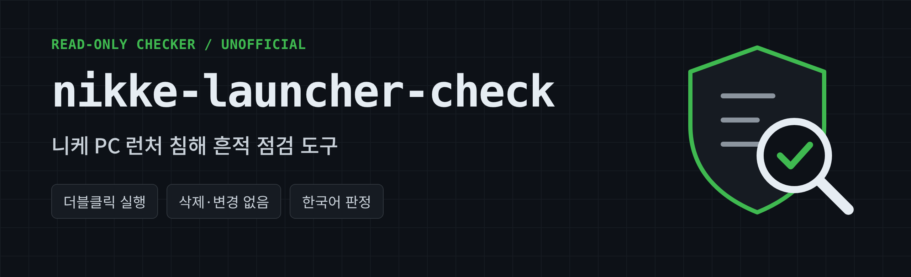

<p align="center"></p>

# nikke-launcher-check

[한국어](README.md) | [English](README.en.md) | [日本語](README.ja.md) | [繁體中文](README.zh-Hant.md) | [简体中文](README.zh-Hans.md)

用於檢查 2026 年 11 月報告的 NIKKE PC 啟動器遭入侵事件已知痕跡的 Windows 工具。

- **唯讀：** 不刪除、不變更、不關閉、不封鎖、不外傳，只顯示警告。
- **不是清除工具。** 只回報痕跡，不會移除。
- **非官方。** 與 SHIFT UP、Level Infinite 無關。

> **「沒有痕跡」不代表安全。** 僅檢查已公開的指標。若在 2026 年 10 月 23 日 (GMT) 之後執行過啟動器，無論結果如何都建議變更主要密碼並登出工作階段。

> **驗證狀態：** v0.3.1 僅在模擬環境測試。登錄檔、簽章與網路檢查尚未在實際 Windows 驗證。翻譯為機器翻譯，錯誤請透過 Issues 回報。

## 使用方式

1. 從 [Releases](../../releases) 下載 zip 並解壓縮。
2. 雙擊 `nikke_check.bat`，不需要系統管理員權限。
3. 請使用玩過 NIKKE 的 Windows 帳戶執行。
4. 結果會顯示在畫面上，並以 `NIKKE_check_日期_時間.txt` 儲存到桌面。

## 使用 AI 檢查

如果您使用能在電腦上執行命令的 AI 工具（Claude、ChatGPT 等），可以貼上以下內容：

```text
請用最新版的 NIKKE PC 啟動器檢查工具檢查這台電腦。
https://github.com/safe-launcher-check/nikke-launcher-check/releases/latest

1. 將發布頁的 zip 下載到新的暫存資料夾並解壓縮。
2. 比對 zip 的 SHA-256 與發布頁的值。不同就停止。
3. 閱讀 nikke_check.ps1，回報是否有刪除、變更或外部連線命令。若有則不要執行。
4. 不使用系統管理員權限，以目前帳戶執行。超過 5 分鐘就停止並回報。
   powershell.exe -NoProfile -ExecutionPolicy Bypass -File .\nikke_check.ps1 -NoPrompt
5. 用淺白的話說明結果。不要把「沒有痕跡」說成安全。

規則：不要刪除或變更檔案、資料夾、登錄檔。不要執行 NIKKE 啟動器。隱藏使用者名稱和電腦名稱，不要寫出密碼或權杖。
```

- **結果為「危險」的電腦上，也不要信任 AI 工具。** 此惡意程式也鎖定 AI 工具的憑證。請在另一台裝置撤銷並重新核發權杖。
- 使用 AI 是選用的，雙擊 `nikke_check.bat` 結果相同。
- AI 的說明可能有誤，請自行查看結果 txt。

**分享結果。** 請在 [X 貼文](https://x.com/DSloss58502/status/2117827841329082426) 回覆或透過 [Issues](../../issues) 分享判定與錯誤。請隱藏使用者名稱、電腦名稱和路徑，不要貼出完整結果 txt。

## 選項

`-Language ko|en|ja|zh-Hant|zh-Hans`, `-NikkePath "D:\NIKKE"`, `-DeepScan`, `-AllUsers`

## 如果顯示「危險」

關閉啟動器或中斷網路。刪除 HKCU 機碼，重新開機，再只刪除 64 位資料夾。切勿刪除整個 PlatformExperienceHelper 資料夾或 HKLM 項目。最安全的做法是重新安裝 Windows。請在另一台乾淨裝置上變更密碼、啟用雙重驗證、登出所有工作階段、重新核發權杖與金鑰，並將加密資產轉到新錢包。

---

來源：[MotherSphere 公開報告](https://gist.github.com/MotherSphere/d6c049a09ba8ac3085c51ee9df24a4e5) 2026-11-04 02:00 GMT 版及留言中的受害回報。並非官方聲明。採 MIT 授權，不提供任何保證。
